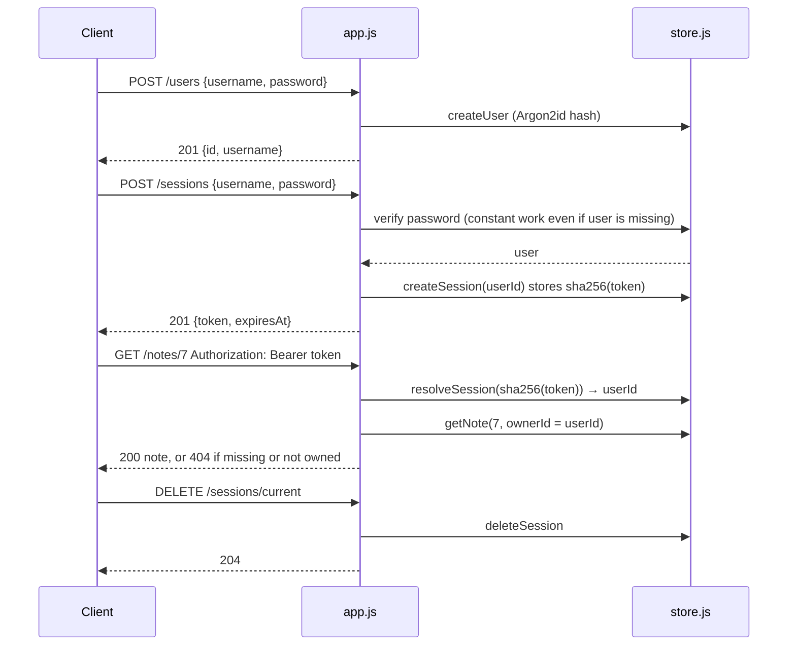

# Proposal: User accounts and per-user notes

Draft for team review (2026-11-15).
Evidence and sources: [research.md](research.md)

## Recommendation

Add self-service username and password accounts. Clients log in once and get an opaque bearer token that the server remembers. All `/notes` endpoints require that token and act only on the caller's notes.

- Passwords are hashed with Argon2id from the built-in `node:crypto` (Node ≥ 24.7). No new dependencies.
- Tokens are 32 random bytes (256 bits) sent as `Authorization: Bearer <token>`. The server stores only a SHA-256 of each token, with idle and absolute expiry, and logout deletes it.
- Each note gets an internal `ownerId`. Store lookups are scoped by owner, so another user's note behaves exactly like a missing one (`404`).

Why this over the alternatives: it fits a single-process, dependency-free JSON API. Logout and expiry work the same way they would with any server-side session. It also avoids the JWT pitfalls in RFC 8725, and a cookie-based browser client can still be added later on top of the same session store.

## Alternatives

| Option | Why not now |
| --- | --- |
| Stateless JWT | Logout needs a server-side denylist anyway; adds a dependency or hand-rolled crypto; algorithm and claim validation pitfalls (RFC 8725). |
| Cookie sessions | Same store, different transport. Needs CSRF protection. Choose this instead if a browser app is the main client (decision D2). |
| External IdP / OIDC | Best if the org already has one, because we would store no passwords. Needs new infrastructure and makes local tests depend on stubs. Revisit if D1 says an IdP exists. |
| Admin-issued API keys | Simplest code, but no self-service sign-up and no expiry. Fine for a few known users only. |
| HTTP Basic on every request | Argon2 costs about 63 ms per hash (measured locally), paid on every request, and the password travels with every call. |

## Request flow



## API contract changes

New endpoints (all JSON):

| Method | Path | Auth | Result |
| --- | --- | --- | --- |
| `POST` | `/users` | none | `201 { id, username }`; `400` invalid input; `409 { "error": "username taken" }` (see D4) |
| `POST` | `/sessions` | none | `201 { token, expiresAt }`; `401 { "error": "invalid credentials" }` for any bad username/password; `429` when throttled |
| `DELETE` | `/sessions/current` | bearer | `204`; the token stops working immediately |
| `GET` | `/users/me` | bearer | `200 { id, username }` |

Changed endpoints: every `/notes` route requires `Authorization: Bearer <token>`.

| Case | Response |
| --- | --- |
| No `Authorization` header | `401`, `WWW-Authenticate: Bearer`, body `{ "error": "unauthorized" }` |
| Malformed, unknown, expired, or logged-out token | `401`, `WWW-Authenticate: Bearer error="invalid_token"`, body `{ "error": "invalid token" }` |
| `GET /notes` | only the caller's notes; `?tag=` filters within them |
| `POST /notes` | note is owned by the caller |
| `GET`/`DELETE /notes/:id` of another user's note | `404 { "error": "not found" }`, the same as a missing note |

Responses that carry a token send `Cache-Control: no-store` (RFC 6750 §4). Tokens are never accepted in query strings.

The public note shape stays `{ id, title, body, tags, createdAt }`, and `ownerId` stays internal (D5). This is a breaking change for current clients, because unauthenticated `/notes` calls start returning `401` (D3).

## Data types (in `src/store.js`)

```js
// User
{ id: number, username: string, passwordHash: string, createdAt: string }
// passwordHash is a PHC-style string so parameters can be raised later:
// "$argon2id$v=19$m=19456,t=2,p=1$<salt b64>$<hash b64>"

// Session (Map key: sha256(token) hex)
{ userId: number, createdAt: number, lastSeenAt: number, expiresAt: number }

// Note gains an internal owner
{ id, ownerId, title, body, tags, createdAt }
```

Store functions take the owner explicitly, so a route cannot forget it:

```js
notes.list({ ownerId, tag })
notes.get(id, ownerId)     // null if missing or not owned
notes.create({ ownerId, title, body, tags })
notes.remove(id, ownerId)  // false if missing or not owned
users.create({ username, passwordHash })
users.findByUsername(username)
sessions.create(userId) → token     // returns raw token once
sessions.resolve(token) → userId | null   // enforces idle and absolute expiry
sessions.remove(token)
```

Rules:

- Usernames are 3–32 characters from `[a-z0-9_-]`, lowercased before storage and lookup.
- Passwords: minimum length per D6. Maximum 256 characters, rejected rather than truncated. Any characters allowed, with no composition rules.
- Login hashes against a fixed dummy hash when the user does not exist, so timing does not reveal valid usernames.
- Failed logins are throttled per username with exponential delay, returning `429` with `Retry-After`. The counters are in memory, like everything else.
- Hashing uses async `crypto.argon2('argon2id', { memory: 19456, passes: 2, parallelism: 1, tagLength: 32, nonce: randomBytes(16) })`, and verification uses `timingSafeEqual`.

## Decisions needed

Each decision has a recommended default, so the work can start if nobody objects.

| ID | Question | Recommended default | Who decides |
| --- | --- | --- | --- |
| D1 | Build accounts in-house or use an existing identity provider? | In-house (option A), unless the org already runs an OIDC provider that should own identity | Team / product owner |
| D2 | Which client transport? | `Authorization: Bearer` header; add `__Host-` cookie + CSRF later only if a browser client appears | Team |
| D3 | Rollout of the breaking change | Require auth on all `/notes` at once (the store is in memory, so no existing data needs an owner); announce to current clients | API owner |
| D4 | Reveal "username taken" on sign-up? | Yes (`409`), accepting enumeration risk for personal notes; mitigated by throttling | Team / security reviewer |
| D5 | Expose `ownerId` on notes? | No; keep the public note shape unchanged | Team |
| D6 | Minimum password length | 15 characters (NIST 800-63B-4 floor without MFA); 8 only if MFA is planned | Security reviewer |
| D7 | Session lifetime | Idle 30 min, absolute 8 h, configurable via env | Team |
| D8 | Persistence | Out of scope: users, sessions, and notes stay in memory and are lost on restart; track persistence as separate work | Team |
| D9 | Minimum runtime | Node ≥ 24.7 for `crypto.argon2`; if deployment runs older, use scrypt (N=2^17, r=8, p=1) behind the same function | Whoever owns deployment |

Out of scope for this proposal: password reset, email verification, MFA, sharing notes between users, admin roles, and persistence.

## Delivery outline (after approval)

The project rules apply to each slice: handlers go in `src/app.js` and data access in `src/store.js`, and every endpoint change updates `docs/api.md` and `test/app.test.js`.

1. Store: owner-scoped note functions plus users and sessions, with unit-level tests. Existing routes pass a fixed owner, so behaviour does not change yet.
2. `POST /users`, `POST /sessions`, `DELETE /sessions/current`, `GET /users/me`, with tests for generic login errors, expiry, and logout.
3. Require bearer auth on `/notes`, and update the existing tests to authenticate. Add the two-user IDOR test: user B gets `404` on `GET`/`DELETE` of user A's note, and A's `GET /notes` never lists B's notes.
4. Update `docs/api.md`, including the `tags` field and `?tag=` filter, which are already undocumented today.

Verification: `npm test` passes, the two-user isolation tests pass, and a manual `curl` session runs sign-up → login → create → list → logout → `401`.

